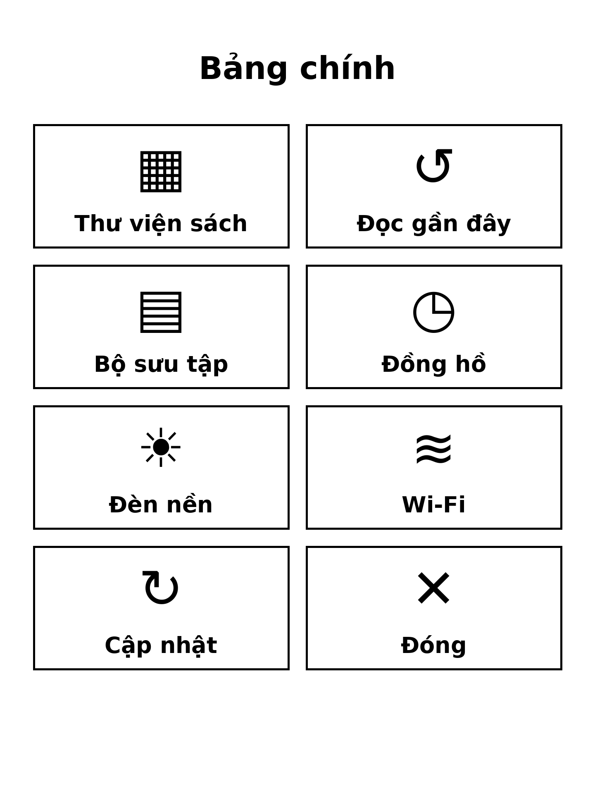

# KOReader Big Menu — bảng biểu tượng ô to & menu phóng to cho máy đọc sách e-ink

**English: [README.md](README.md)** · **Cài đặt chi tiết: [INSTALL.md](INSTALL.md)**

Menu của KOReader rất mạnh nhưng được thiết kế cho cú chạm chính xác:
chữ nhỏ, dòng thấp, nhiều tầng. Trên màn hình e-ink — làm mới chậm,
ngón tay to — việc mò menu như vậy thực sự khó chịu.

**Big Menu** xử lý bằng hai phần bổ trợ nhau:

1. **Bảng biểu tượng chính** — lưới ô to toàn màn hình (Thư viện,
   Sách đọc gần đây, Bộ sưu tập, Đèn nền, Wi-Fi, Cập nhật), mỗi ô một
   biểu tượng lớn kèm nhãn chữ lớn. Một chạm một việc, khỏi lặn menu.
2. **Patch phóng to toàn cục** — một *user patch* chính thức của
   KOReader, làm mọi menu có sẵn to lên: dòng cao hơn, chữ lớn hơn,
   ít mục mỗi trang hơn, chữ danh sách sách to hơn — những menu vẫn
   phải dùng thì ít nhất cũng dễ ấn.

Cả hai phần đều **tự cập nhật qua OTA** từ chính repo này: cài một
lần duy nhất, về sau không bao giờ phải cắm cáp nữa — kể cả để sửa
một cỡ chữ.

---

## Gồm những gì

| Phần | Việc nó làm | Vị trí trên máy |
|---|---|---|
| `bigmenu.koplugin` | Bảng biểu tượng, tự cài patch, cập nhật OTA | `.adds/koreader/plugins/bigmenu.koplugin/` |
| `patches/2-bigmenu.lua` | Phóng to toàn bộ menu KOReader | `.adds/koreader/patches/2-bigmenu.lua` |

Bạn chỉ cần chép **một** thứ: cài plugin, nó sẽ tự ghi patch giúp
lần đầu chạy (xem mục Cách hoạt động).

## Mức phóng to, bằng số

Số liệu là giá trị mặc định trong mã nguồn KOReader so với giá trị
patch đặt. Cỡ đều đi qua `Screen:scaleBySize()` nên tự đúng theo
DPI của từng máy.

| Thành phần | Mặc định KOReader | Big Menu | Ở đâu |
|---|---|---|---|
| Chiều cao dòng menu chính (`Size.item.height_large`) | 50 | **68** | TouchMenu (mọi menu trên) |
| Chữ trong menu (`smallinfofont`) | 22 | **28** | Từng mục TouchMenu |
| Nhãn tab menu (`ffont`) | 20 | **25** | Thanh tab TouchMenu |
| Chữ giao diện / nút bấm (`cfont`) | 24 | **27** | Hộp thoại, nút, bảng này |
| Tiêu đề (`tfont`) | 26 | **28** | Tiêu đề hộp thoại |
| Số mục menu mỗi trang (`max_per_page_default`) | 10 | **8** | Phân trang TouchMenu |
| Số mục danh sách mỗi trang (khóa `items_per_page`) | tự động | **8** | Danh sách thư viện, lịch sử, bộ sưu tập |
| Cỡ chữ danh sách (khóa `items_font_size`) | tự động (≤24) | **26** | Các danh sách trên |

## Cách hoạt động

### Bảng biểu tượng (`bigmenu.koplugin`)

Là plugin KOReader thông thường (một file `main.lua`, không phụ
thuộc gì ngoài KOReader). Nó đăng ký:

- mục menu **Công cụ → “Big Menu — bảng biểu tượng”** với *Mở bảng
  biểu tượng*, *Cập nhật bản mới (OTA)* và dòng phiên bản;
- một **hành động Dispatcher** *“Big Menu — bảng biểu tượng”* (sự
  kiện `ShowBigMenu`) — gán nó cho một cử chỉ bất kỳ (ví dụ chạm giữ
  góc màn hình) trong cài đặt cử chỉ của KOReader là mở được bảng từ
  mọi nơi, kể cả giữa trang sách, không qua menu nào.

Mỗi ô là một `InputContainer` có vùng chạm riêng, một biểu tượng
FontAwesome cỡ `60` (KOReader có sẵn font ký hiệu Nerd Fonts làm
font dự phòng nên vẽ được mà không cần file icon nào) và nhãn in đậm
cỡ `30`. Hành động của ô chỉ dùng cơ chế công khai của KOReader:
`ReaderUI:showFileManager()`, sự kiện phát rộng `ShowHist` /
`ShowColl`, `Device:getPowerDevice():toggleFrontlight()` và
`NetworkManager:toggleWifiOn/Off()` — tất cả bọc `pcall` để nếu
KOReader đổi API thì chỉ hỏng một ô, không sập bảng.

### Patch (`patches/2-bigmenu.lua`)

KOReader hỗ trợ chính thức *user patch*: file Lua trong
`koreader/patches/` chạy lúc khởi động. Patch tiền tố `2-` chạy sau
khi cài đặt đã sẵn sàng. Patch:

1. nâng các mục trong `Font.sizemap` (bảng cỡ chữ danh nghĩa mà
   `Font:getFace()` đọc);
2. nâng `Size.item.height_*` và ghi đè `TouchMenu.item_height` /
   `TouchMenu.max_per_page_default` trên class — mọi menu tạo sau đó
   đều thừa hưởng kích thước lớn;
3. ghi đúng hai khóa cài đặt chính thức của KOReader là
   `items_per_page` và `items_font_size`, mà các widget `Menu`
   (thư viện, lịch sử, bộ sưu tập) đọc lúc khởi tạo.

Mỗi bước bọc `pcall` riêng: bản KOReader tương lai đổi tên nội bộ
thì bước đó tự bỏ qua, không làm lỗi khởi động. Xóa file patch và
khởi động lại là KOReader về nguyên bản (hai khóa danh sách có thể
xóa trong `settings.reader.lua` để KOReader tự tính lại).

### Ai cập nhật patch? Chính plugin.

Nội dung patch được nhúng trong plugin (giống hệt byte với
`patches/2-bigmenu.lua` trong repo — script đóng gói tự chèn).
Khi menu chính của KOReader được dựng lần đầu sau khi cài, plugin
so phiên bản ở đầu file patch trên máy với bản của nó và ghi bản
mới hơn nếu cần, rồi nhắc khởi động lại. Bộ cập nhật OTA (dưới đây)
tải patch mới cùng lúc với plugin nên hai phần không bao giờ lệch
nhau.

### Cập nhật OTA

*Mở menu plugin → “Cập nhật bản mới (OTA, cần Wi-Fi)”*, hoặc chạm ô
**Cập nhật bản mới** trong bảng. Bộ cập nhật:

1. tải `bigmenu.koplugin/_meta.lua` từ nhánh `main` của repo này và
   đọc phiên bản trên mạng;
2. so sánh phiên bản theo số (ngữ nghĩa `x.y.z`) và **chỉ nâng
   cấp** — từ chối “cập nhật” xuống bản cũ hơn hoặc bằng, nên máy
   đang chạy bản mới hơn repo không bao giờ bị hạ cấp;
3. tải `main.lua` và `patches/2-bigmenu.lua`, kiểm tra kích thước và
   chuỗi nhận dạng trước khi động vào bất cứ file nào trên máy;
4. thay file, giữ `main.lua.bak` dự phòng, ghi `_meta.lua` và patch
   mới, rồi nhắc khởi động lại KOReader.

Không máy tính, không cáp, không phải mò file trên máy đọc sách.

## Cài đặt

Tóm tắt (từng bước đầy đủ trong [INSTALL.md](INSTALL.md)):

1. Chép thư mục **`bigmenu.koplugin`** vào
   `.adds/koreader/plugins/` trên máy đọc sách.
2. Khởi động lại KOReader, mở menu Công cụ một lần — plugin tự ghi
   `patches/2-bigmenu.lua` và báo bằng một thông báo.
3. Khởi động lại KOReader thêm lần nữa. Xong: menu đã to, bảng biểu
   tượng nằm ở *Công cụ → Big Menu* (gán thêm một cử chỉ cho nó để
   mở bằng một chạm ở mọi nơi).

Cũng có thể chép tay `patches/2-bigmenu.lua` — tiện nếu bạn chỉ
muốn phần phóng to mà không cần bảng biểu tượng.

## Tùy chỉnh

Không có màn hình cài đặt; các giá trị phóng to là hằng số chọn cho
máy 8″ 300 dpi (Kobo Sage). Muốn chỉnh, sửa `patches/2-bigmenu.lua`
(chỉ là vài con số trong ba khối nhỏ đầu file):

| Núm chỉnh | Khối | Tác dụng |
|---|---|---|
| Các giá trị `Font.sizemap.*` | 1 | Cỡ chữ mục menu, tab, hộp thoại, tiêu đề |
| `Size.item.height_*`, `TouchMenu.item_height` | 2 | Chiều cao dòng menu |
| `TouchMenu.max_per_page_default` | 2 | Số mục menu mỗi trang (ít hơn = dòng cao hơn) |
| `items_per_page`, `items_font_size` | 3 | Mật độ và cỡ chữ danh sách sách |

Vì plugin ghi lại patch khi bản nhúng của nó mới hơn, bản sửa tay
của bạn giữ nguyên cho tới bản phát hành plugin tiếp theo — hãy
tăng dòng phiên bản ở đầu patch tự sửa nếu muốn nó trụ qua các lần
OTA cùng phiên bản plugin.

## Hạn chế đã biết

- Biểu tượng dựa vào font dự phòng Nerd Fonts có sẵn của KOReader
  (`nerdfonts/symbols.ttf`). Bản dựng nào thiếu font đó thì ô vẫn
  bấm được — nhãn chữ nói rõ chức năng — nhưng biểu tượng có thể
  hiện thành ô trống.
- Patch phóng to các menu KOReader dựng **sau** khi khởi động; nó
  không đổi typography trong sách, và bố cục menu đọc sách chỉ thay
  đổi ở các cỡ chữ toàn cục nêu trên.
- OTA cần Wi-Fi bật và tới được GitHub; không có kiểm tra cập nhật
  nền/theo lịch — cập nhật là một chạm chủ động.
- Hai khóa danh sách (`items_per_page`, `items_font_size`) được ghi
  vào cài đặt của chính KOReader; xóa patch không xóa chúng (xóa
  khóa đi, hoặc kệ — chúng là cài đặt KOReader bình thường).

## Xử lý sự cố

| Triệu chứng | Nguyên nhân & cách sửa |
|---|---|
| Không thấy mục **Big Menu** trong menu Công cụ | Chưa khởi động lại KOReader thật sự sau khi chép, hoặc chép sai chỗ — đường dẫn phải là `.adds/koreader/plugins/bigmenu.koplugin/main.lua` |
| Bảng mở được nhưng menu vẫn nhỏ | Patch chưa được ghi hoặc chưa khởi động lại từ lúc ghi — mở menu Công cụ một lần, chờ thông báo xác nhận, khởi động lại KOReader, kiểm tra có file `patches/2-bigmenu.lua` |
| Một ô bấm không có tác dụng | Bản KOReader đó đổi API nội bộ; ô đó hỏng lặng theo thiết kế (`pcall`). Mở issue kèm phiên bản KOReader |
| Biểu tượng hiện ô trống | Bản dựng thiếu font dự phòng Nerd Fonts — nhãn chữ vẫn cho biết từng ô là gì |
| OTA báo “không cập nhật được” | Wi-Fi tắt, không tới được GitHub, hoặc file tải về không qua kiểm tra — kiểm tra Wi-Fi rồi thử lại |
| Menu giờ to quá / nhỏ quá | Sửa hằng số trong `patches/2-bigmenu.lua` (xem mục Tùy chỉnh), hoặc xóa patch để về mặc định |

## Phát triển

- `bigmenu.koplugin/main.lua` là file **được sinh ra**: sửa
  `plugin_template.lua` trong workspace của dự án, giữ
  `patches/2-bigmenu.lua` là nguồn duy nhất của nội dung patch, và
  chạy bước build chèn patch vào placeholder `__PATCH_SOURCE__`.
- Kiểm tra cú pháp mọi file Lua trước khi phát hành bằng parser Lua
  (`luaparser` / LuaJIT `luajit -bl` — KOReader chạy LuaJIT).
- Phiên bản theo ngữ nghĩa; con số phiên bản sống ở ba nơi phải
  khớp nhau: `BIGMENU_VERSION` trong `main.lua`, `version` trong
  `_meta.lua`, và dòng đầu patch `-- BigMenu patch | version: x.y.z`.

## Trạng thái & phiên bản

- **Phiên bản 1.0.0** — bản phát hành công khai đầu tiên (xem
  [CHANGELOG.md](CHANGELOG.md)).
- Phát triển và kiểm thử trên **Kobo Sage** (8″, 1440×1920,
  300 ppi) chạy KOReader; các cơ chế dùng (user patch, cỡ chữ danh
  nghĩa, hình học `Size`, hành động Dispatcher) không phụ thuộc
  thiết bị.

## Giấy phép

MIT — xem [LICENSE](LICENSE).
